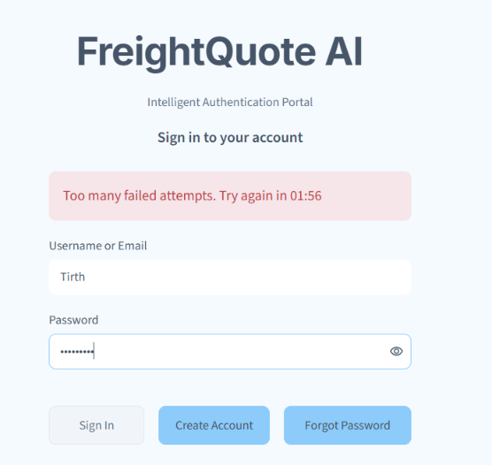
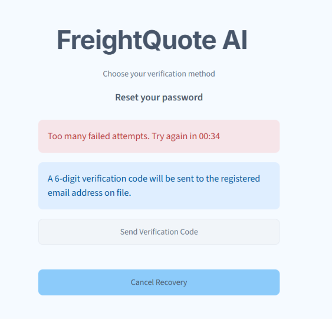
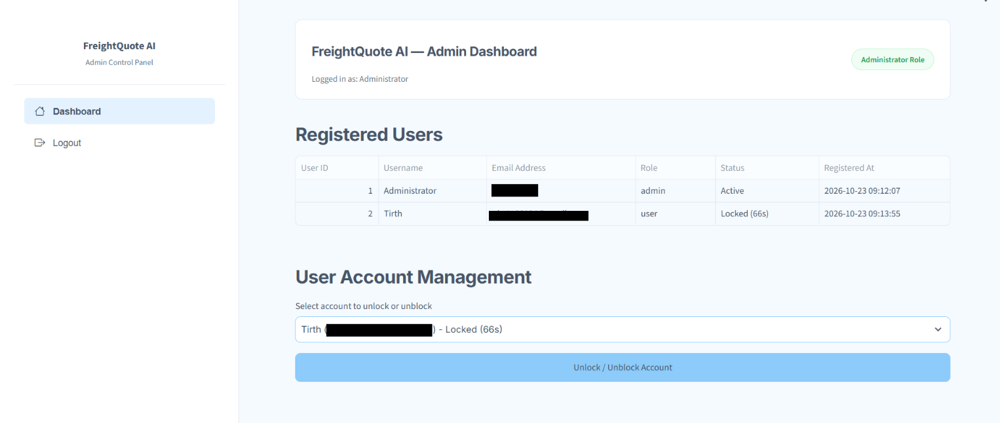

# FreightQuote AI — Authentication Module

## 1. Project Overview

FreightQuote AI is a project focused on making maritime freight quotation and shipping-related tasks easier. The main project aims to bring together information about shipping routes, freight prices, weather conditions, customs rules, and profit margins.

This milestone focuses on the authentication module. It provides a way for users to create accounts, log in, and recover their accounts if they forget their passwords. It also protects accounts with login and recovery lockouts, saves data in Google Drive so it is kept between sessions, and includes separate dashboards for administrators and regular users.

## 2. Objectives

The main objectives of this milestone are:

- To allow new users to register and existing users to log in.
- To provide an account recovery option for users who forget their passwords.
- To verify users through security questions and email OTP verification.
- To allow users to reset their passwords after successful verification.
- To protect accounts from repeated wrong attempts using temporary locks and blocking.
- To store user information in an SQLite database.
- To provide separate dashboards for administrators and regular users.

## 3. Features

| Feature | Description |
|---|---|
| **User Registration** | Users sign up with a username, email, password, and a security question and answer. The password needs 8+ characters with uppercase, lowercase, digit, and symbol. The security answer is one word and case sensitive. After signing up, the user is taken to the Sign In page. |
| **User Login** | Users sign in with a username or an email. The session lasts 2 hours and continues after a page refresh. |
| **Login Protection** | 3 free wrong attempts, then locks of 2, 5, and 10 minutes with a live countdown. A regular user is then permanently blocked until an administrator unblocks the account. The administrator account is never permanently blocked. |
| **Forgot Password** | Users reset their password through a security question or an email OTP. The last 5 passwords cannot be reused. A refresh does not restart the recovery. |
| **Email OTP** | A 6-digit code is sent by email and is valid for 5 minutes. It is stored only as a hash. A new code can be requested after 60 seconds. After verification, the user has 10 minutes to set the new password. |
| **Recovery Protection** | 3 wrong OTP or security-answer attempts lock recovery for 1 minute. After that, each wrong attempt locks it again for 3, 5, and then 10 minutes. |
| **Role-Based Dashboards** | The administrator sees all users with their status (Active, Locked, or Blocked) and can unlock or unblock accounts. Regular users see their account details. |

## 4. Technologies Used

| Technology | Purpose |
|---|---|
| Python | Main programming language |
| Streamlit | Building the web interface |
| SQLite | Storing user account information |
| bcrypt | Hashing passwords |
| JWT | Managing token-based verification |
| SMTP | Sending OTP emails |
| Google Colab / Jupyter Notebook | Developing and running the notebook |

## 5. Project Structure

The files for this milestone are organized as follows:

```text
Milestone1/
├── README.md
├── FreightQuote_AI_Authentication.ipynb
├── otp_service.py                
├── app.py                         
└── screenshots/
    ├── login_page.png
    ├── signup_page.png
    ├── forgot_password_page.png
    ├── security_question_verification.png
    ├── email_otp_verification_page.png
    ├── email_otp_verification.png
    ├── reset_password_page.png
    ├── login_lockout.png
    ├── recovery_block.png
    ├── admin_dashboard.png
    ├── admin_unblock_blocked_account.png
    └── user_dashboard.png

Google Drive/
└── MyDrive/FreightQuoteDB/
    └── infosys_portal.db         
```

## 6. Database Tables

The database file is saved in Google Drive, so user accounts are kept after Colab restarts.

| Table | Purpose |
|---|---|
| `users` | User accounts, hashed passwords, and security answers |
| `password_history` | Previous passwords, to stop reuse |
| `login_attempts` | Wrong login attempts, locks, and blocked status |
| `recovery_attempts` | Wrong recovery attempts, locks, and OTP resend wait |
| `recovery_sessions` | Current recovery step, so a refresh does not restart it |

## 7. Setup Guide

### 7.1 Mount Google Drive

```python
from google.colab import drive
drive.mount('/content/drive')

import os
os.makedirs('/content/drive/MyDrive/FreightQuoteDB', exist_ok=True)
```

### 7.2 Install Packages

```python
!pip install -q "streamlit>=1.38.0" streamlit-option-menu pyngrok pyjwt bcrypt plotly extra-streamlit-components
```

### 7.3 Create a Gmail App Password (for sending OTP emails)

1. Sign in to the Gmail account that will send the OTP emails.
2. Turn on 2-Step Verification in your Google Account.
3. Open the App Passwords page and create a new App Password (for example, `FreightQuote AI`).
4. Copy the 16-character password and save it as `EMAIL_PASSWORD` in Colab Secrets.

### 7.4 Set Up ngrok in Google Colab

1. Create a free account on the ngrok website.
2. Copy your Authtoken from the ngrok dashboard.
3. Save it as `NGROK_AUTHTOKEN` in Colab Secrets.

### 7.5 Add Colab Secrets

Click the key icon in the left sidebar of Colab, choose **Add new secret**, enter the name and value, and turn on **Notebook access**.

| Secret name | Purpose |
|---|---|
| `EMAIL_ID` | Gmail address that sends the OTP emails |
| `EMAIL_PASSWORD` | Gmail App Password for sending OTP emails |
| `JWT_SECRET` | Signs login sessions and OTP tokens |
| `NGROK_AUTHTOKEN` | Creates the public ngrok URL |

## 8. How to Run

1. Add the four secrets from section 7.5.
2. Run the cells in order: mount Google Drive, install packages, create `otp_service.py`, and create `app.py`.
3. Run the launch cell. It starts Streamlit and prints the **FreightQuote AI Live URL**.
4. Open the URL, then sign in as the administrator or create a new account.

## 9. System Workflow

1. A new user creates an account, or an existing user logs in with a username or email.
2. The application checks the credentials and whether the account is locked or blocked.
3. After a successful login, the user is directed to the administrator or user dashboard.
4. After 3 wrong attempts the account is locked with increasing wait times, and a regular user may be blocked until an administrator unblocks the account.
5. If a user forgets their password, they choose to recover it through a security question or an email OTP.
6. For the security question, the user answers it correctly. For the email OTP, the user enters the code sent to the registered email.
7. Wrong recovery attempts are limited, and too many of them lock recovery for a short time.
8. After successful verification, the user sets a new password and signs in again.

## 10. Application Screenshots

The following screenshots show the different pages of the authentication module.

### 10.1 Login Page

This page allows registered users to log in to their accounts.


### 10.2 Signup Page

This page allows new users to create an account.


### 10.3 Forgot Password Page

This page allows users to start the password recovery process.


### 10.4 Security Question Verification

This page asks the user to answer their registered security question.


### 10.5 Email OTP Verification

This page allows users to enter the OTP received in their registered email account.


### 10.6 OTP Email Received in Gmail

This screenshot shows the OTP email received in Gmail during the verification process.


### 10.7 Reset Password Page

This page allows users to set a new password after completing the required verification steps.


### 10.8 Login Lockout

This screenshot shows the login page when an account is temporarily locked after too many wrong attempts.



### 10.9 Recovery Lockout

This screenshot shows password recovery being locked after too many wrong OTP or security answer attempts.



### 10.10 Admin Dashboard

This page shows the dashboard available to the administrator.


### 10.11 Admin Unlock / Unblock Account

This section allows the administrator to unlock or unblock a locked or blocked account.



### 10.12 User Dashboard

This page shows the dashboard available to regular users.


## 11. Security Considerations

The authentication module includes password hashing, email OTP verification, login and recovery lockouts, and token-based verification features.

The following points should be considered when using or deploying the application:

- Passwords should not be stored as plain text.
- OTPs should have a limited validity period.
- Email credentials, secret keys, and other sensitive information should not be shared publicly.
- Default administrator credentials should be changed before deployment.
- User information should be handled carefully to protect privacy.

## 12. Milestone Deliverables and Status

The following items are included in this milestone:

- Authentication module notebook.
- User registration and login pages.
- Login lockout and account blocking with an administrator unblock option.
- Password recovery and reset pages.
- Security question and email OTP verification pages.
- Admin and user dashboards.
- Screenshots of the application's main pages.
- Documentation describing the module and its workflow.

This milestone provides the authentication functionality for the FreightQuote AI project. Further milestones can build on this foundation by adding the other planned features of the platform.
