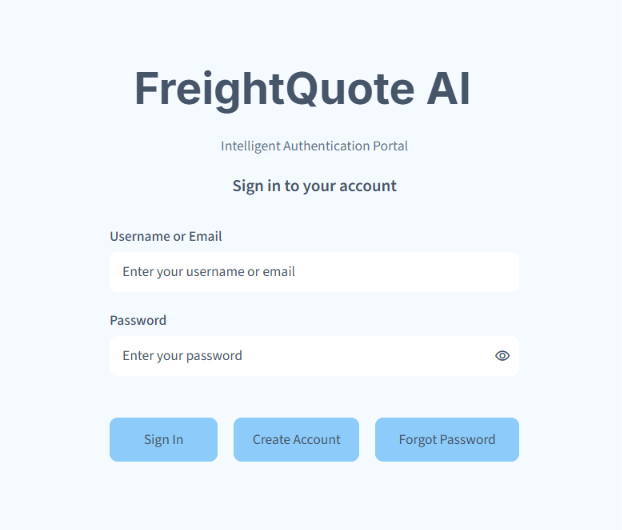
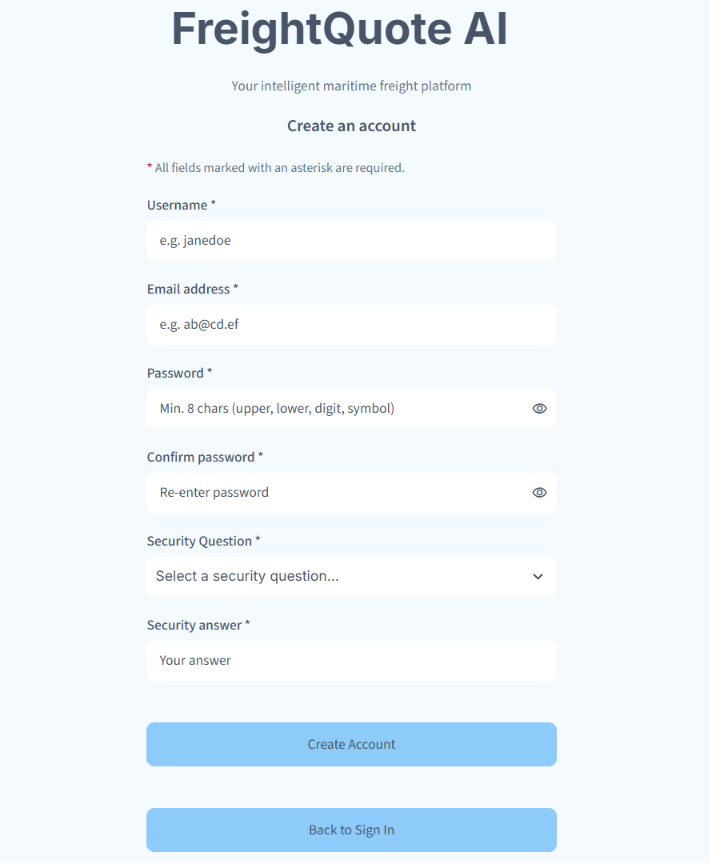
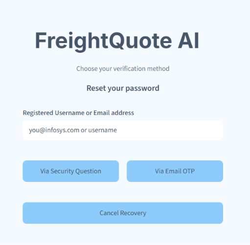
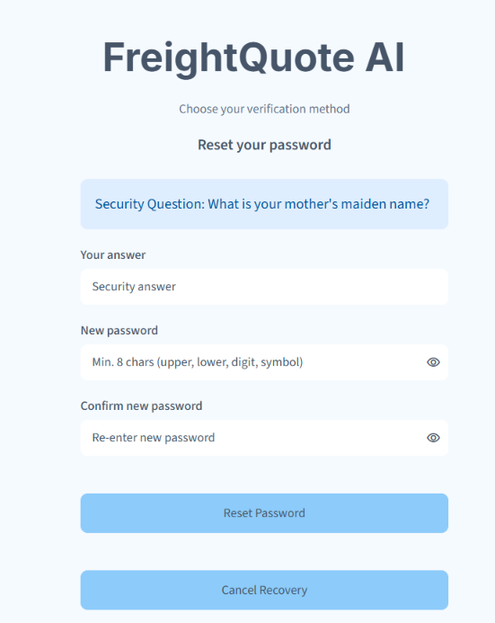
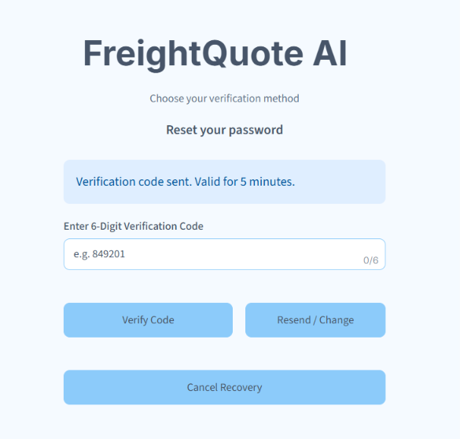
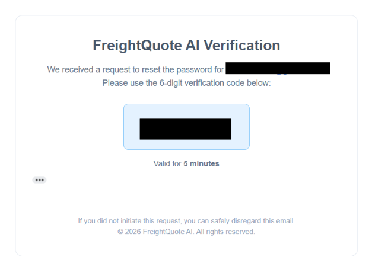
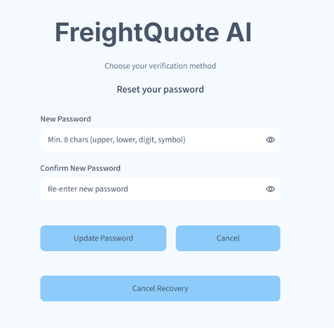
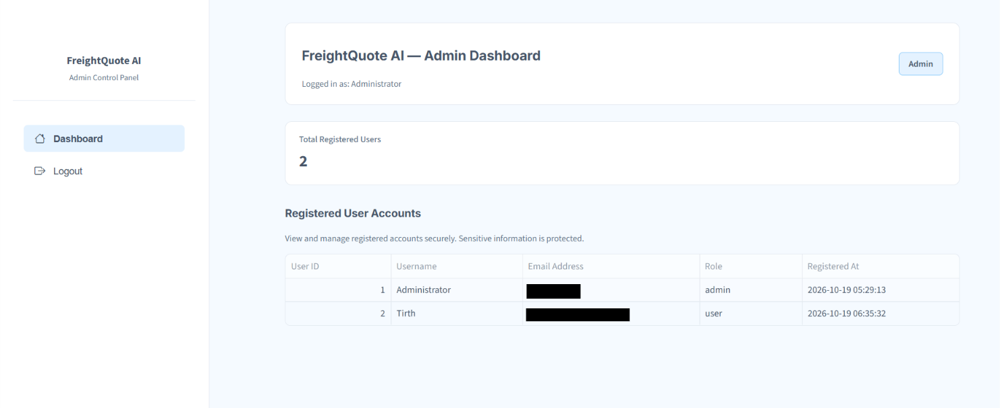
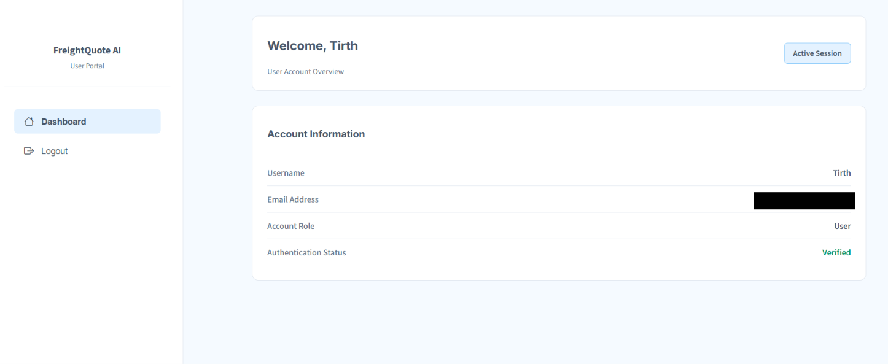

# FreightQuote AI — Authentication Module

## 1. Project Overview

FreightQuote AI is a project focused on making maritime freight quotation and shipping-related tasks easier. The main project aims to bring together information about shipping routes, freight prices, weather conditions, customs rules, and profit margins.

This milestone focuses on the authentication module. It provides a way for users to create accounts, log in, and recover their accounts if they forget their passwords. It also includes separate dashboards for administrators and regular users.

## 2. Objectives

The main objectives of this milestone are:

- To allow new users to register and existing users to log in.
- To provide an account recovery option for users who forget their passwords.
- To verify users through security questions and email OTP verification.
- To allow users to reset their passwords after successful verification.
- To store user information in an SQLite database.
- To provide separate dashboards for administrators and regular users.

## 3. Features Implemented

### User Registration

New users can create an account by entering the required information.

### User Login

Registered users can log in using their credentials.

### Forgot Password

Users can start the password recovery process if they forget their passwords.

### Security Question Verification

Users can answer their registered security question as part of the account recovery process.

### Email OTP Verification

A one-time password (OTP) is sent to the user's registered email address for verification.

### Password Reset

After completing the required verification steps, users can set a new password.

### Role-Based Dashboards

The application provides different dashboards for administrators and regular users based on their roles.

### Password Security

The application uses password hashing and password history features to help protect user accounts.

## 4. Technologies Used

| Technology | Purpose |
|---|---|
| Python | Main programming language |
| Streamlit | Building the web interface |
| SQLite | Storing user account information |
| bcrypt | Hashing passwords |
| JWT | Managing token-based verification |
| SMTP | Sending OTP emails |
| Google Colab / Jupyter Notebook | Developing and running the notebook |

## 5. System Workflow

The authentication module follows these steps:

1. A new user creates an account or an existing user logs in.
2. The application checks the user's credentials.
3. After successful login, the user is directed to the appropriate dashboard.
4. If a user forgets their password, they can start the recovery process.
5. The user completes security question verification.
6. The application sends an OTP to the registered email address.
7. The user enters the OTP for email verification.
8. After successful verification, the user can reset their password.

## 6. Project Structure

The files for this milestone are organized as follows:

```text
Milestone1/
├── README.md
├── FreightQuote_AI_Authentication.ipynb
└── screenshots/
    ├── login_page.png
    ├── signup_page.png
    ├── forgot_password_page.png
    ├── security_question_verification.png
    ├── email_otp_verification_page.png
    ├── email_otp_verification.png
    ├── reset_password_page.png
    ├── admin_dashboard.png
    └── user_dashboard.png
```

## 7. Application Screenshots

The following screenshots show the different pages of the authentication module.

### 7.1 Login Page

This page allows registered users to log in to their accounts.



### 7.2 Signup Page

This page allows new users to create an account.



### 7.3 Forgot Password Page

This page allows users to start the password recovery process.



### 7.4 Security Question Verification

This page asks the user to answer their registered security question.



### 7.5 Email OTP Verification

This page allows users to enter the OTP received in their registered email account.



### 7.6 OTP Email Received in Gmail

This screenshot shows the OTP email received in Gmail during the verification process.



### 7.7 Reset Password Page

This page allows users to set a new password after completing the required verification steps.



### 7.8 Admin Dashboard

This page shows the dashboard available to the administrator.



### 7.9 User Dashboard

This page shows the dashboard available to regular users.



## 8. Security Considerations

The authentication module includes password hashing, email OTP verification, and token-based verification features.

The following points should be considered when using or deploying the application:

- Passwords should not be stored as plain text.
- OTPs should have a limited validity period.
- Email credentials, secret keys, and other sensitive information should not be shared publicly.
- Default administrator credentials should be changed before deployment.
- User information should be handled carefully to protect privacy.

## 9. Milestone Deliverables and Status

The following items are included in this milestone:

- Authentication module notebook.
- User registration and login pages.
- Password recovery and reset pages.
- Security question and email OTP verification pages.
- Admin and user dashboards.
- Screenshots of the application's main pages.
- Documentation describing the module and its workflow.

This milestone provides the authentication functionality for the FreightQuote AI project. Further milestones can build on this foundation by adding the other planned features of the platform.
