# FreightQuote AI — Milestone 2

**Infosys Springboard 7.0 · Batch 4 · Milestone 2**
FastAPI · SQLite · JWT · Role-Based Access Control · Google Colab · ngrok

FreightQuote AI is a multi-user freight workspace. Milestone 1's secure login was integrated into the provided FreightQuote back end, and the app now has a landing page, five roles with server-enforced permissions, a Profile page, an Admin dashboard and a SQL-only AI Copilot, together with the six freight agents (Route, Spot Quotes, Carriers, Weather, Margin, Customs).

---

## 1. How to run (Google Colab)

1. Open `FreightQuote_AI_Milestone2_Final11.ipynb` in Google Colab and use a **CPU** runtime.
2. Open **Secrets** (key icon, left sidebar) and add the following. Turn **Notebook access** on for each one. Never type a secret into a notebook cell.

   | Secret | Purpose | Required |
   | --- | --- | --- |
   | `JWT_SECRET` | Signs login tokens (32+ characters) | Yes |
   | `ADMIN_PASSWORD` | Password of the first Admin account (12–72 bytes, upper/lower/number/symbol) | Yes |
   | `EMAIL_ADDRESS` | Gmail address that sends OTP emails | For email OTP |
   | `EMAIL_PASSWORD` | Gmail **app password** (not the normal password) | For email OTP |
   | `ADMIN_EMAIL` | Email of the first Admin account | Optional |
   | `NGROK_AUTHTOKEN` | Public link fallback if Colab's link is blocked | Optional |

3. Choose **Runtime → Run all**. The cells install the environment, write the source files, validate them (preflight) and start the server. The final cell checks the login and all page endpoints, then prints **Launch Web Application**. If `NGROK_AUTHTOKEN` is set it also prints a public ngrok link.
4. Sign in with username `admin` and your `ADMIN_PASSWORD`.
5. Open **Admin Dashboard** and create one account for each of the other roles (see section 3). Public sign-up only creates **Customer** accounts.
6. To show a Customer's own data, link the Customer to a corporate freight profile: either enter an existing customer ID (for example `CUST-002`) when creating the account, or use **Link Customer Account** on the Admin Dashboard for a customer who signed up publicly.

> Colab's `/content` storage is temporary. If the runtime is reset, run all cells again and re-create the test users.

---

## 2. What was built

| Area | What it does |
| --- | --- |
| **Landing page** | Approved maritime landing page (Platform, How it works, Security, FAQ) with Log in and Create account. |
| **Sign-up / Login** | Milestone 1 flow in FastAPI: `POST /api/auth/signup`, `/login`, `/forgot`, `/reset` plus email verification. Email needs 2+ letters before `@`, between `@` and the dot, and after it. Password needs 8+ characters with upper case, lower case, a number and a symbol. Confirm password must match. |
| **Forgot password** | Six-digit email OTP (5-minute expiry, resend limits) or security question, then reset. |
| **Security** | Passwords are hashed (bcrypt, PBKDF2 fallback), never stored in plain text. JWT sessions (HS256, 2 hours) are sent as `Authorization: Bearer`. The same error text is returned for an unknown email and a wrong password. Wrong-password ladder: 3 wrong tries = 2-minute wait, 4 = 5-minute wait, 5 = account locked until an Admin unlocks it. Locked or deleted users and old sessions are rejected on every request. |
| **Profile page** | Shows username, email, role, customer ID, joined date and last active session. The password hash is never displayed. The user can change the username and the password, each after entering the current password. A new password cannot repeat the current or a recent password, and it must follow the Milestone 1 rules. |
| **RBAC** | `rbac.py` holds `ROLE_MENU` (pages per role) and `ROLE_CAPS` (actions per role). The server checks them for pages, record details and every action route, so typing `/api/page/<id>` directly also returns **403**. |
| **Admin Dashboard** | Admin-only page with KPI cards (total, active and locked accounts, with a count per role), a *Platform Accounts & Access Control* table (username, email, role, status, customer ID, joined date, last login), a *Provision New User Account* form with validation, a role drop-down (promote/demote), Lock/Unlock and Delete (with a confirmation step) on every row, the **RBAC privilege matrix**, **Link Customer Account** (connects a publicly signed-up Customer to an existing corporate freight profile so they see their own quotes and shipments), and an *Admin Activity Audit Log* of the latest 50 admin actions. |
| **AI Copilot** | Answers only from the database using whitelisted SQL. Shows the SQL and the row count for each answer. Greets politely, handles common spelling mistakes, replies to out-of-scope questions with three valid suggestions, and respects the user's role. |
| **Design** | One consistent maritime theme, responsive layout, light/dark switch, loading states and clear error messages. |

### Admin protections

- An Admin cannot lock or delete their own account.
- The last remaining active Admin cannot be demoted, locked or deleted.
- Lock, role change and delete take effect immediately because the session is checked on every request.
- Every admin action (who, what, when), including linking a customer account, is written to the activity log.
- No page or API response contains a password or hash.

---

## 3. Roles and privileges

| Role | Who is this | Privileges |
| --- | --- | --- |
| **Admin** | Platform operator | Everything: all pages, create quotes, inject storms, manage users and roles, view the activity log |
| **Operations Manager** | Runs logistics | Route, Carriers, Weather, Customs, Copilot; may run agents, re-route and edit customs; cannot manage users |
| **Freight Broker** | Sells and prices | Copilot, Quotes (create and view), Carriers, Margin; cannot inject storms or edit customs |
| **Auditor** | Compliance reviewer | Read-only access to every page; cannot create quotes or run agents |
| **Customer** | External shipper | Copilot (own shipments and quotes only) and Quotes for their own account; no other pages |

### Page access matrix

| Role | Copilot | Route | Quotes | Carriers | Weather | Margin | Customs | Run agents | Users |
| --- | :---: | :---: | :---: | :---: | :---: | :---: | :---: | :---: | :---: |
| Admin | ✓ | ✓ | ✓ | ✓ | ✓ | ✓ | ✓ | ✓ | ✓ |
| Operations Manager | ✓ | ✓ | ✗ | ✓ | ✓ | ✗ | ✓ | ✓ | ✗ |
| Freight Broker | ✓ | ✗ | ✓ | ✓ | ✗ | ✓ | ✗ | ✗ | ✗ |
| Auditor | ✓ | ✓ | ✓ | ✓ | ✓ | ✓ | ✓ | ✗ | ✗ |
| Customer | ✓ | ✗ | Own only | ✗ | ✗ | ✗ | ✗ | ✗ | ✗ |

Every role can also open **My Profile**. Only Admin can open the **Admin Dashboard**. The Customer sees only quotes and shipments linked to their own `customer_id`, in the Quotes page, in record details and in the Copilot.

---

## 4. AI Copilot

The Copilot has **no LLM and no RAG**. Each question is matched to one of **18 whitelisted, parameterised SQL queries** (spelling variants are normalised first). The answer, the exact SQL and the number of rows are returned, so nothing is made up.

### Question patterns

| # | Question (examples) | Roles allowed |
| --- | --- | --- |
| 1 | Which carrier is cheapest to Rotterdam? | Admin, Ops Manager, Broker, Auditor |
| 2 | How many shipments are on customs hold? | Admin, Ops Manager, Auditor |
| 3 | Show quotes below 10% margin | Admin, Ops Manager, Broker, Auditor |
| 4 | Which ports are most congested? | Admin, Ops Manager, Broker, Auditor |
| 5 | Show storms near the Red Sea | Admin, Ops Manager, Broker, Auditor |
| 6 | Which shipments have a high delay risk? | Admin, Ops Manager, Broker, Auditor |
| 7 | How many shipments are delayed? | Admin, Ops Manager, Broker, Auditor |
| 8 | Show carrier reliability rankings | Admin, Ops Manager, Broker, Auditor |
| 9 | What are my active shipments? | Customer, Admin, Broker |
| 10 | Show my recent quotes | Customer, Admin, Broker |
| 11 | Who are our top spending customers? | Admin, Broker, Auditor |
| 12 | Show customs rules with high duty rates | Admin, Ops Manager, Broker, Auditor |
| 13 | Show active vessels progress at sea | Admin, Ops Manager, Auditor |
| 14 | Show quotes by carrier | Admin, Ops Manager, Broker, Auditor |
| 15 | Show shipments from <port> | Admin, Ops Manager, Auditor |
| 16 | What are the longest port dwell days? | Admin, Ops Manager, Broker, Auditor |
| 17 | Show severe weather risks | Admin, Ops Manager, Auditor |
| 18 | What is the fleet health score? | Admin, Ops Manager, Broker, Auditor |

Typo tolerance covers cases such as `cheepest carier to roterdam`, `shipmnts`, `margn` and `delyed`.

### Tested questions and answers

These were run against the seeded demo database through the Copilot engine. **The seed data is regenerated on every fresh Colab run, so the exact values below can differ in your session**; the questions, SQL and behaviour are what matter.

| Role | Question | Result | Rows | SQL used |
| --- | --- | --- | :---: | --- |
| Freight Broker | Which carrier is cheapest to Rotterdam? | COSCO Shipping, average price $1,866.18 (1 quote) | 1 | `SELECT COALESCE(q.carrier, s.carrier), ROUND(AVG(q.final_price),2), COUNT(*) FROM freight_quotes q LEFT JOIN shipments s … WHERE LOWER(s.dest_port) LIKE '%rotterdam%' …` |
| Freight Broker | `cheepest carier to roterdam` (typos) | Same answer as above | 1 | same query |
| Freight Broker | Show quotes below 10% margin | QTE-0024 (9.1%), QTE-0028 (9.1%), QTE-0040 (9.9%) | 3 | `SELECT … FROM freight_quotes q WHERE q.margin_pct < 10.0 ORDER BY q.margin_pct ASC LIMIT 10` |
| Operations Manager | Which ports are most congested? | Shanghai Port 4.20, Lagos Apapa Port 4.00, Ningbo-Zhoushan Port 3.90 … | 5 | `SELECT port_id, port_name, country, congestion_index, avg_dwell_days FROM ports ORDER BY congestion_index DESC LIMIT 5` |
| Auditor | What are the longest port dwell days? | Kolkata Haldia, Shanghai, Ningbo-Zhoushan … (5.00 days) | 6 | `SELECT port_name, country, avg_dwell_days, congestion_index FROM ports ORDER BY avg_dwell_days DESC LIMIT 6` |
| Auditor | Show customs rules with high duty rates | Beverages 20%, Vehicles and parts 15%, Cereals 12% … | 6 | `SELECT chapter, goods, duty_pct, docs FROM customs_rules ORDER BY duty_pct DESC LIMIT 6` |
| Freight Broker | Who are our top spending customers? | Corporate Client 001 ($32,144.00), Corporate Client 010, Corporate Client 011 … | 5 | `SELECT c.name, … SUM(q.final_price) … FROM customers c JOIN freight_quotes q … ORDER BY total_spend DESC LIMIT 5` |
| Admin | Show severe weather risks | Ports ranked by wind speed with severity and forecast | 6 | `SELECT port_name, current_severity, forecast, wind_speed, wave_height FROM weather_risks ORDER BY wind_speed DESC LIMIT 6` |
| Customer (`CUST-002`) | Show my recent quotes | Only that customer's quotes | 2 | `SELECT … FROM freight_quotes WHERE customer_id = 'CUST-002' ORDER BY created_at DESC LIMIT 10` |
| Customer (`CUST-002`) | What are my active shipments? | Only shipments linked to that customer's quotes | 2 | `SELECT … FROM freight_quotes q JOIN shipments s … WHERE q.customer_id = 'CUST-002' …` |
| Admin | `hello` | Greeting plus suggested questions for the role | 0 | none |
| Admin | What is the weather in Paris tomorrow? | Polite reply: only database questions are answered, with three valid suggestions | 0 | none |
| Customer | Which ports are most congested? | **Access Restricted** (role scoping) | 0 | none |
| Customer | Show quotes by carrier | **Access Restricted** (role scoping) | 0 | none |

---

## 5. Test plan (one real account per role)

| Check | Expected |
| --- | --- |
| Sign up, verify email, log in, forgot password with OTP | Works; wrong password and unknown email show the same message |
| Five wrong passwords | Account locked; only an Admin can unlock |
| Profile: change username (wrong current password / invalid name / taken name / valid name) | Error, error, error, success |
| Profile: change password with a weak password / valid password | Rejected / success and sign-in again |
| Admin: add, change role, lock, unlock, delete (with confirmation) | Works and appears in the activity log |
| Admin: lock or delete own account; remove the last Admin | Refused |
| Locked user with an existing token | Refused on the next request |
| Customer opens Weather page or calls a restricted action | **403** |
| Customer reads Quotes / Copilot | Only own records |
| Quote pipeline and storm | A generated quote; Weather page changes after a storm is injected |

---

## 6. Screenshots

All screenshots are in the `screenshots/` folder.

### Landing page
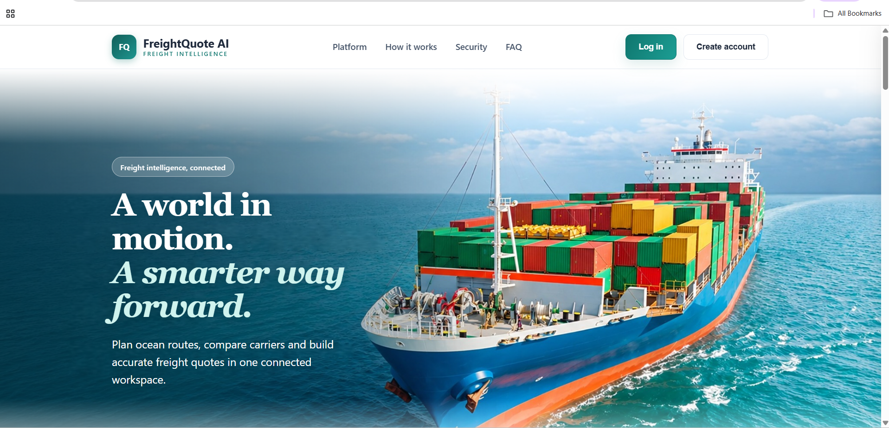

### Login and sign-up
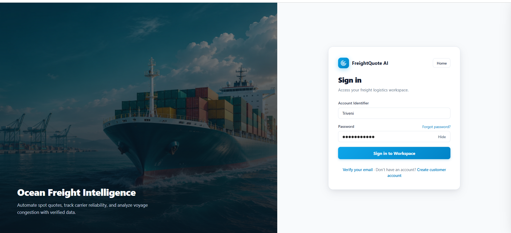
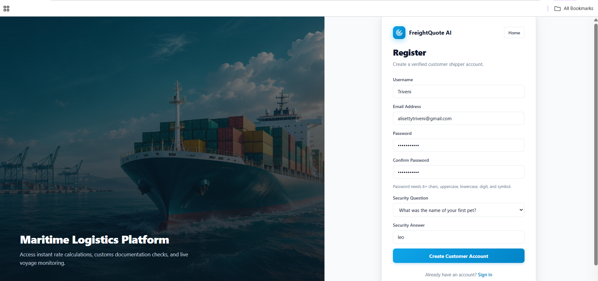
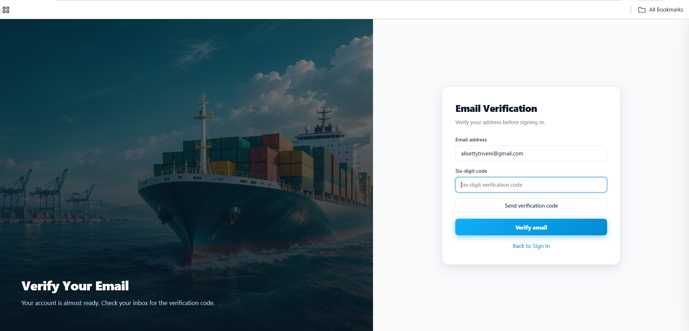

### Profile page

### Admin dashboard with users table
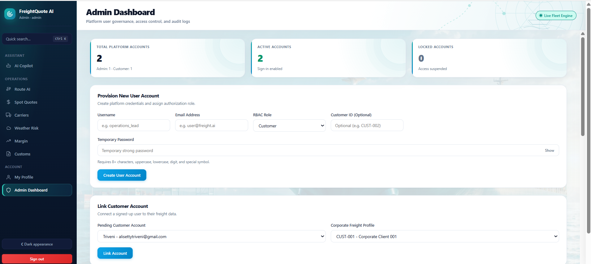
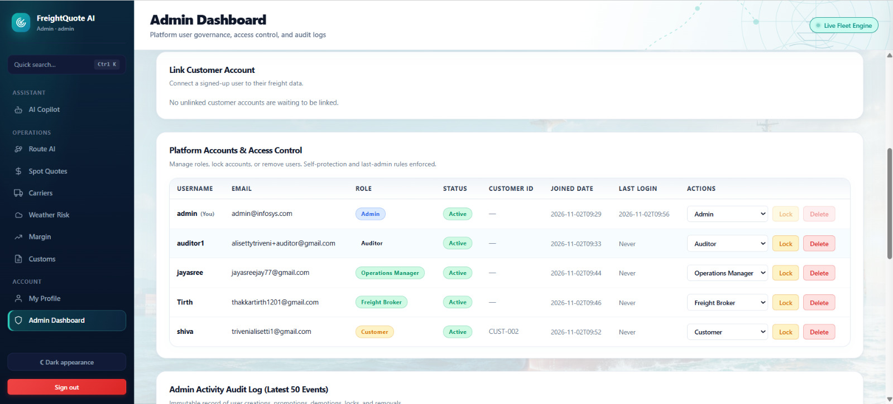
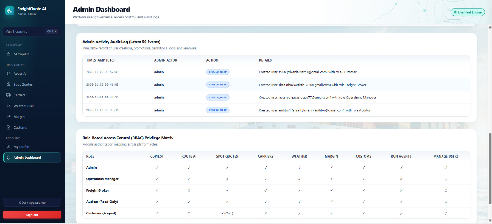

### Denied (403) action for a restricted role
A Customer opening the Route module is refused with 403.

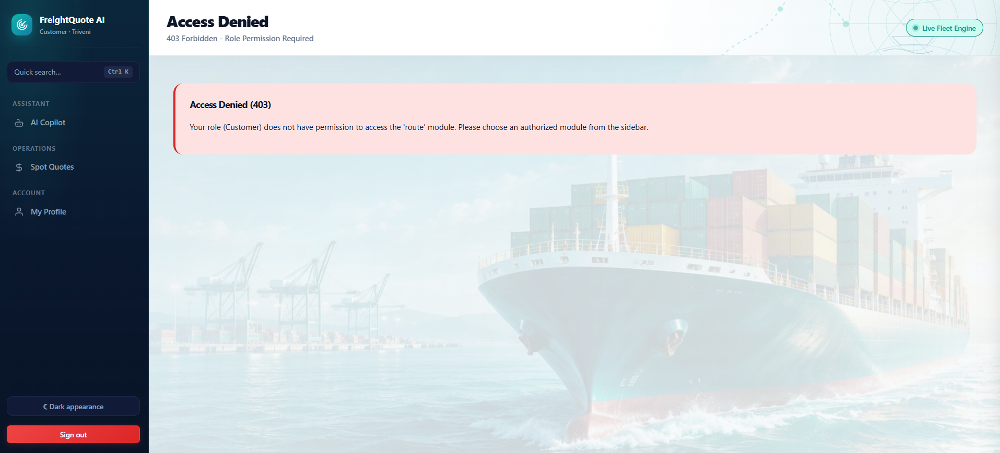

### Role matrix
The role matrix is in section 3 of this README, in the Admin Dashboard (above) and in the notebook.

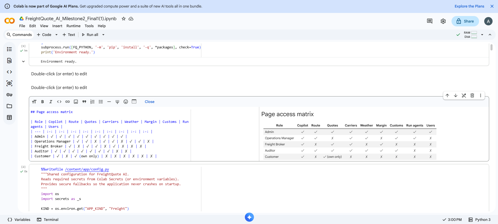

### AI Copilot: a greeting and an exact question
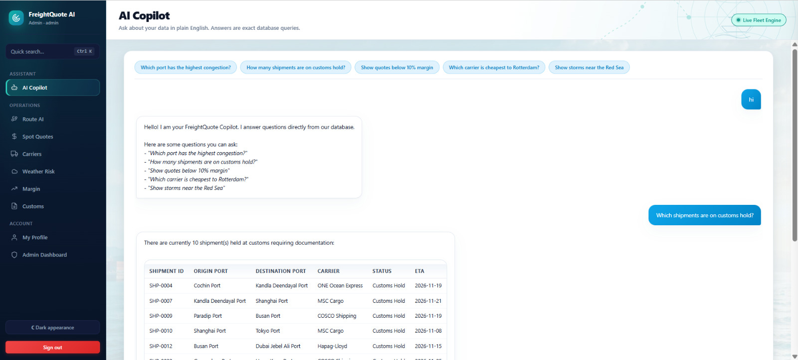

### Generated quote
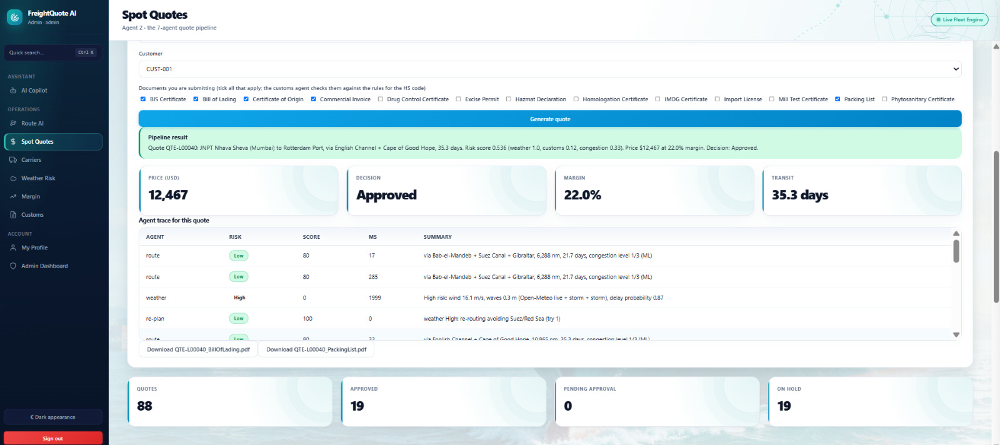

### Weather Risk page after a storm
With storm cells injected, the Weather Risk page shows 4 active storms and 2 vessels in high risk (live Open-Meteo data for 252 ports).

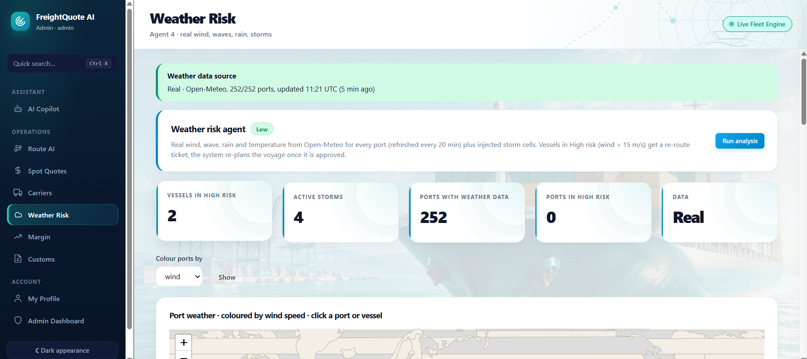

---
## 7. Team contributions

| Member | Work |
| --- | --- |
| Tirth | Profile page (view, username and password change, validation, saving changes) and role-specific views |
| Aparna  | Milestone 1 landing page added to the provided code, UI updates and consistent styling, role-specific UI changes |
|  Triveni | Admin Dashboard and RBAC permissions for all five roles |
| Shivam  | AI Copilot: data connection, 18 SQL question patterns, error handling and unsupported-question replies |

