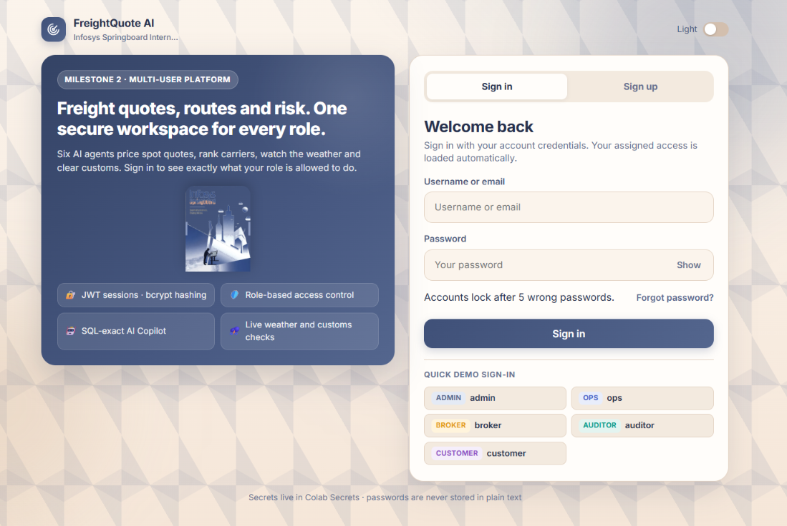
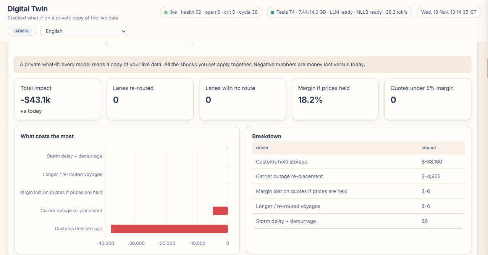
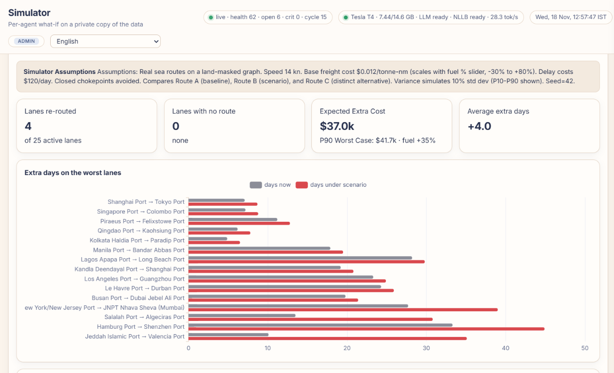
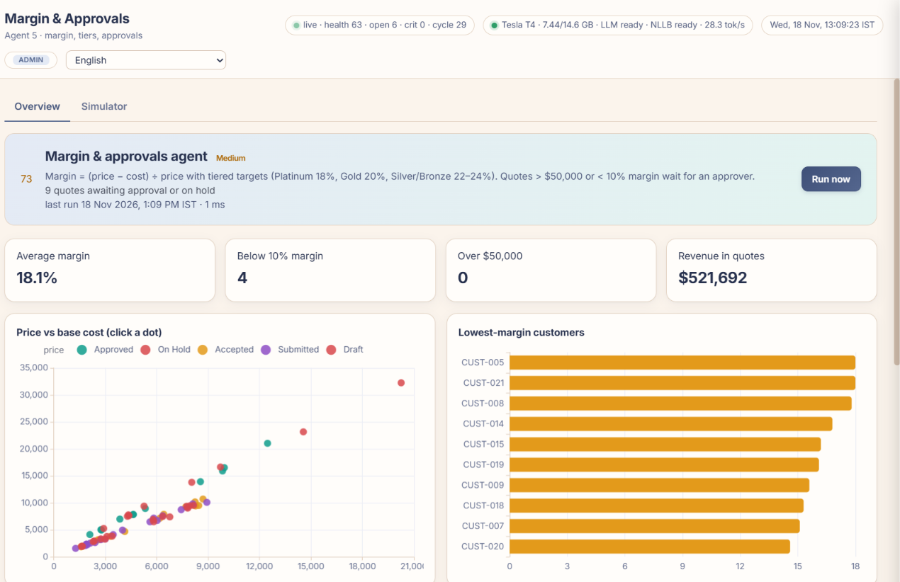
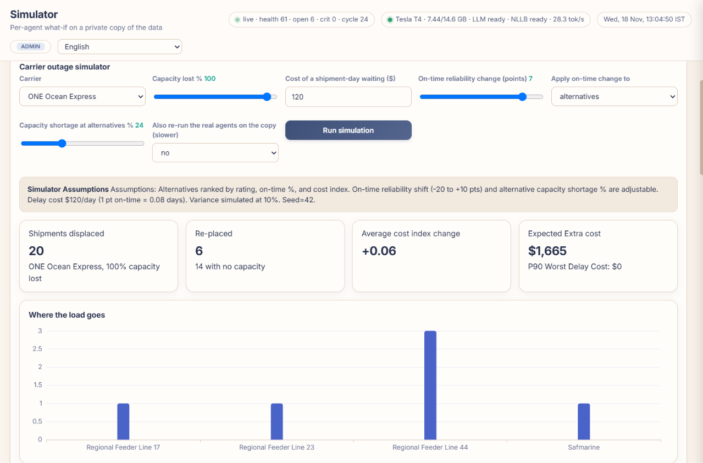
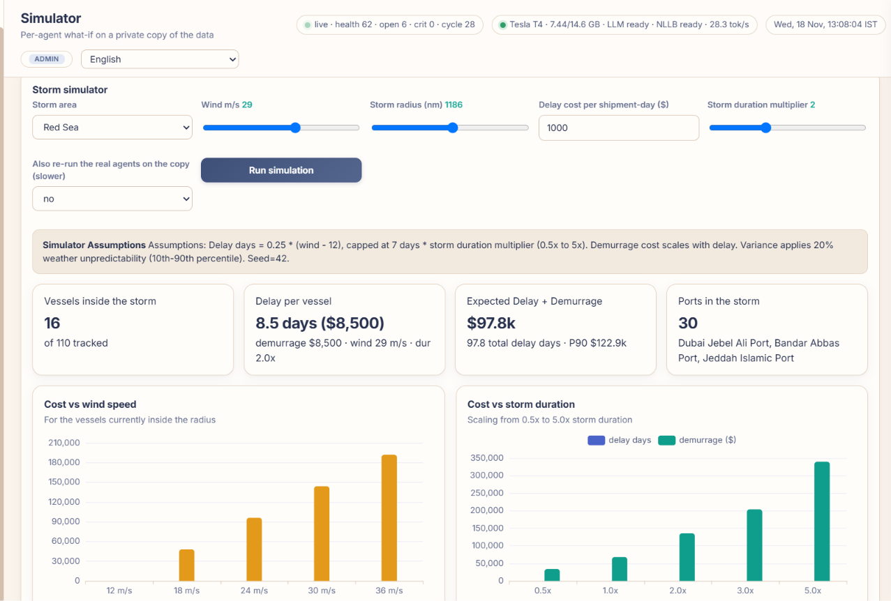

<h1 align="center">FreightQuote AI</h1>

<b>Agentic AI for Maritime Freight Pricing and Route Optimization</b>

Infosys Springboard 7.0 Internship &nbsp;|&nbsp; Batch 4 &nbsp;|&nbsp; Team 2 &nbsp;|&nbsp; Milestone 3

  
  
  
  
  

  <a href="#overview">Overview</a> &nbsp;·&nbsp;
  <a href="#how-to-run">How to run</a> &nbsp;·&nbsp;
  <a href="#roles-and-access">Roles</a> &nbsp;·&nbsp;
  <a href="#how-the-copilot-uses-sql-and-rag">Copilot</a> &nbsp;·&nbsp;
  <a href="#knowledge-base-sources-and-chunks">Knowledge base</a> &nbsp;·&nbsp;
  <a href="#simulator-improvements">Simulators</a> &nbsp;·&nbsp;
  <a href="#screenshots">Screenshots</a> &nbsp;·&nbsp;
  <a href="#team">Team</a>

---

## Overview

FreightQuote AI is a web application in which a team of AI agents prices freight quotes, watches the fleet for weather, customs and congestion risk, and proposes actions that people approve. An AI Copilot answers questions in plain English. Every number it states comes from an exact SQL query, and its explanations come from a knowledge base of freight documents, cited with numbered sources. When the Copilot is not sure, it says "I do not know".

**Mentor:** Mohamedsipli M

### Milestone 3 at a glance

| Goal | Result |
|---|---|
| Knowledge base | 56 websites and 241 PDFs, indexed as 9,130 chunks |
| Taught questions | 160 questions taught through Admin > Teach Copilot |
| Simulators | 5 agent simulators upgraded, each with assumptions, a P10 to P90 range and a fixed seed |
| Final application | Milestone 2 login, profile, role-based access and Admin dashboard running inside it |
| Deliverables | Both notebooks, taught_questions.csv, this README and the presentation (PPTX and PDF) |

---

## Tech stack

| Part | Technology | Why |
|---|---|---|
| Backend | FastAPI (Python) | Fast, typed and easy to demo live |
| Database | SQLite, backed up to Google Drive | One file that the Copilot can query exactly |
| Agents | LangGraph | Plans and re-plans are visible steps |
| Models for pricing and anomalies | Random Forest, Isolation Forest | Price prediction and unusual quotes |
| Knowledge base | FAISS and BM25, rank fusion, cross-encoder reranker | Cited answers from documents |
| Language model | Qwen2.5-Instruct (3B on a T4) | Writes short explanations from evidence |
| Translation | NLLB-200 (distilled 600M) | 37 languages |
| Embeddings | paraphrase-multilingual-MiniLM-L12-v2 | Finds passages by meaning |
| Reranker | cross-encoder/ms-marco-MiniLM-L-6-v2 | Puts the best passage first |
| Front end | Plain JavaScript single-page app | No build step |
| Runtime | Google Colab with a T4 GPU, ngrok as a fallback link | Free GPU |

All models load on the GPU when the app starts, and their state is shown in Admin > GPU and models.

---

## How to run

You need a Google account, Google Colab with a GPU runtime (T4) and Google Drive.

### Step 1: Build the knowledge base (RAG notebook)

1. Open `FreightQuoteAI_RAG_Builder_FINAL_.ipynb` in Colab.
2. Choose **Runtime > Change runtime type > T4 GPU**.
3. Choose **Runtime > Run all** and allow access to Google Drive when Colab asks.
4. The notebook crawls the websites, downloads the PDFs, extracts the text and builds the indexes. Everything is saved to `MyDrive/FreightQuote_AI/`:
   - `rag_pdfs/` holds the downloaded PDFs.
   - `synthetic_kb/all_chunks.jsonl` holds the chunks that the app reads.
   - `faiss_indexes/` and `bm25_indexes/` hold the search indexes.
   - `kb_export.json` is an export that can be imported in the app.

### Step 2: Start the application (final notebook)

1. Open `Copy_of_FreightQuote_AI_Final_Code_UI_FIXED.ipynb` in Colab with a **T4 GPU**.
2. In the start cell, keep `USE_DRIVE = True` and `PERSIST = True`. This loads the chunks from Step 1 and backs up the database to `MyDrive/freight_quote_data/db`.
3. Add secrets in Colab (the key icon, with Notebook access turned on). None of them is required to start.

   | Secret | Use |
   |---|---|
   | `NGROK_AUTHTOKEN` | Public link if Colab's own link is blocked |
   | `ADMIN_PASSWORD` | Your own admin password (optional) |
   | `ADMIN_EMAIL_ID` | Admin login email (optional) |
   | `JWT_SECRET_KEY` | Session signing key (optional, one is generated if missing) |
   | `HF_TOKEN` | Hugging Face token for faster downloads (optional) |

4. Choose **Runtime > Run all** and open the link printed at the end.
5. Sign in. The sign-in page has a **Quick demo sign-in** list with one user per role.
6. Open **Admin > System check**. The line **Knowledge base (RAG)** shows how many chunks are loaded.

Start the notebook about 15 minutes before a demo, because the models take a few minutes to load.

---

## Roles and access

| Role | What it can do |
|---|---|
| Customer | Requests quotes and sees only their own |
| Freight Broker | Handles quotes and customs documents |
| Operations Manager | Approves re-routes, holds and margin reviews, and runs agent cycles |
| Auditor | Read-only access |
| Admin | Everything above, plus policy, users, System check and Teach Copilot |

A role that tries something it is not allowed to do receives a **403** response and a clear message. Self-registered accounts are always Customers, and only an Admin can give another role.

---

## Agents, approvals and the Digital Twin

**Seven quote agents** build a quote: route, weather, pricing, customs, margin, documents and alerts.

**Five fleet watchers** run every 60 seconds and open tickets when they find a problem: `route_watch`, `weather_watch`, `customs_watch`, `quote_watch` and `anomaly_watch`.

**People stay in control.** Actions such as re-routes, quote holds and margin reviews go to an approval queue. Approvals follow a two-step chain (Operations Manager, then Admin), and every action is written to an audit log.

**The Digital Twin** runs what-if cases, such as a port strike, a fuel spike or a canal closure, on a private copy of the data. It shows the money impact, ranks the ways to reduce it, and never changes live data.

---

## How the Copilot uses SQL and RAG

The Copilot tries these layers in order. The first one that can answer wins.

1. **Taught answers.** If an Admin taught this question, or a rephrased version of it, the saved answer is returned.
2. **Small talk and repair.** Greetings, typos and follow-up questions such as "and for Maersk only?".
3. **Exact SQL.** The question is turned into a read-only database query. Every number the Copilot states comes from here, and the query can be shown.
4. **Agents.** For briefings and "why is this on hold" questions, the latest findings of the agents are added.
5. **RAG (knowledge base).** For "what is..." and "how do..." questions, the Copilot searches the documents and answers in short numbered points, `[1]` `[2]`, with a **Sources** list.
6. **Language model.** If it is loaded, Qwen2.5 writes a short explanation from the evidence. The code checks that every number it uses is in the evidence.
7. **"I do not know".** If nothing fits, the Copilot says so and saves the question in a backlog, so an Admin can teach the answer.

**How retrieval works.** The knowledge base is searched in two ways. BM25 matches the words, and embeddings match the meaning. The two ranked lists are combined with Reciprocal Rank Fusion, and a cross-encoder reranker puts the best passages first. Identical queries are cached until the knowledge base changes.

---

## Knowledge base: sources and chunks

Collected by web scraping with the RAG notebook.

| Item | Count |
|---|---|
| Seed URLs | 118 |
| Websites | 56 |
| PDFs found by the crawler | 252 (168 downloaded, 77 already cached, 7 failed) |
| Real PDFs after cleaning | 241 |
| Documents kept | 242 |
| Chunks indexed | **9,130** |
| FAISS vectors | 9,130 (384 dimensions) |

Topics covered: Incoterms, customs and HS codes, shipping documents, container and cargo types, freight rates and surcharges, demurrage and detention, ports and congestion, weather and route risk, marine insurance and trade finance. Main sources include UNCTAD's Review of Maritime Transport (several years), World Customs Organization reports, and public customs and regulatory pages.

---

## Questions taught to the Copilot

160 questions were taught through **Admin > Teach Copilot** with a CSV import. The file is [`taught_questions.csv`](taught_questions.csv), with the columns `question`, `answer` and `keywords`.

| Group | Questions | Examples |
|---|---|---|
| Shipping terms and basics | 50 | CIF, ETD, Certificate of Origin |
| About FreightQuote AI | 20 | Why a quote is On Hold, which models the Copilot uses, the Digital Twin |
| Incoterms | 10 | FCA, CPT, CIP, CFR, DAP, DPU |
| Customs and HS codes | 16 | HS code structure, customs valuation, Bill of Entry |
| Shipping documents | 14 | Master and house bill of lading, sea waybill, VGM |
| Demurrage, detention and ports | 14 | Free time, dwell time, blank sailing |
| Weather and route risk | 8 | Suez and Cape routing, monsoon, war risk insurance |
| Marine insurance and trade finance | 14 | Institute Cargo Clauses, letter of credit, UCP 600 |
| Rates and surcharges | 14 | BAF, CAF, THC, FAK, spot and contract rates |

The milestone target is 50 taught questions. This file has 160 (50 + 20 + 90).

---

## Simulator improvements

Each agent page has a **Simulator** tab (code in `sim_fq.py`). Every simulator now lists its assumptions, shows a 10th to 90th percentile range and not a single number, uses a fixed seed (42) so results repeat, reads its starting values from the database, and never changes live data.

| Simulator | What was added |
|---|---|
| Route | Canal and strait closures, a fuel price slider (-30% to +80%), and a comparison of three routes (A baseline, B scenario, C alternative) by days and cost |
| Quote | Target margin, fuel and exchange-rate changes, a price band (P10, P50, P90) and the chance of winning the quote |
| Carrier | On-time reliability shift (-20 to +10 points), capacity shortage, and a carrier ranking under a disruption |
| Weather | Storm intensity and duration (0.5x to 5x), delay days and the demurrage cost |
| Customs | Inspection rate (0 to 50%), missing-document delays, and the holding cost per day over 1 to 14 days |

---

## Milestone 2 work in the final app

- **Login and sign-up:** salted password hashing, a session cookie with a JWT, account lock after 5 wrong passwords, and password reset by security question or email code.
- **Profile page:** user details, preferences and password change.
- **Role-based access:** the menu changes by role, and forbidden actions return 403.
- **Admin dashboard:** Runtime, GPU and models, Decisions, Users and access, Audit log, Copilot insights, Teach Copilot, System check, Data governance and Data.
- **IST on every timestamp**, and no secrets in the code.

---

## Screenshots

All images are in the [`screenshots`](screenshots) folder.

### 1. Application

<table>
  <tr>
    <td align="center" width="50%"> <b>Figure 1.</b> Sign in, with quick demo logins for each role</td>
    <td align="center" width="50%"> <b>Figure 2.</b> Approvals: tickets from the agents waiting for a decision</td>
  </tr>
  <tr>
    <td align="center" width="50%"> <b>Figure 3.</b> Digital Twin: what-if simulation on a private copy of the data</td>
    <td align="center" width="50%"></td>
  </tr>
</table>

### 2. Admin

<table>
  <tr>
    <td align="center" width="50%"> <b>Figure 4.</b> Admin > GPU and models: the models loaded on the T4 GPU</td>
    <td align="center" width="50%"> <b>Figure 5.</b> Admin > Data</td>
  </tr>
</table>

### 3. Route simulator

<table>
  <tr>
    <td align="center" width="50%"> <b>Figure 6.</b> Route planner</td>
    <td align="center" width="50%"> <b>Figure 7.</b> Route simulator: baseline</td>
  </tr>
  <tr>
    <td align="center" width="50%"> <b>Figure 8.</b> Route simulator: scenario</td>
    <td align="center" width="50%"> <b>Figure 9.</b> Route simulator: comparison of routes</td>
  </tr>
</table>

### 4. Quote simulator

<table>
  <tr>
    <td align="center" width="50%"> <b>Figure 10.</b> Quote simulator</td>
    <td align="center" width="50%"> <b>Figure 11.</b> Quote simulator: scenario with a price band</td>
  </tr>
  <tr>
    <td align="center" width="50%"> <b>Figure 12.</b> Margin</td>
    <td align="center" width="50%"></td>
  </tr>
</table>

### 5. Carrier simulator

<table>
  <tr>
    <td align="center" width="50%"> <b>Figure 13.</b> Carrier simulator</td>
    <td align="center" width="50%"> <b>Figure 14.</b> Carrier simulator: ranking under a disruption</td>
  </tr>
</table>

### 6. Weather simulator

<table>
  <tr>
    <td align="center" width="50%"> <b>Figure 15.</b> Weather simulator: delay days and demurrage cost</td>
    <td align="center" width="50%"></td>
  </tr>
</table>

<!--
Add these when the screenshots are saved in the screenshots folder, then remove the comment markers.
Place each block in the group where it belongs and renumber the figures.

### Customs simulator
<table>
  <tr>
    <td align="center" width="50%"> <b>Figure.</b> Customs simulator: inspection rate and holding cost per day</td>
  </tr>
</table>

### Copilot and knowledge base
<table>
  <tr>
    <td align="center" width="50%"> <b>Figure.</b> Admin > System check: Knowledge base (RAG) with the chunk count</td>
    <td align="center" width="50%"> <b>Figure.</b> Admin > Teach Copilot: the taught-question counter</td>
  </tr>
  <tr>
    <td align="center" width="50%"> <b>Figure.</b> A Copilot answer with numbered sources [1] [2]</td>
    <td align="center" width="50%"> <b>Figure.</b> Admin > Copilot insights: answer rate before and after</td>
  </tr>
</table>
-->

---

## Team

Team 2, Batch 4, Infosys Springboard 7.0

| Member |
|---|
| Bhargav Srikar Chegu |
| Bhavana Gudavalli |
| Tirth Tusharkumar Thakkar |
| Chetana P Kulkarni |
| Shivam Kumar |

**Mentor:** Mohamedsipli M

---

## Data and security notes

- Weather and wave data are real, from Open-Meteo. Vessel positions, rates and shipments are simulated until real feeds are connected.
- All times are shown in India Standard Time (IST).
- No passwords, tokens or API keys are stored in the code or in this repository. Secrets are read from Colab Secrets.
- The database is not committed to the repository. It is backed up to Google Drive while the app runs.
