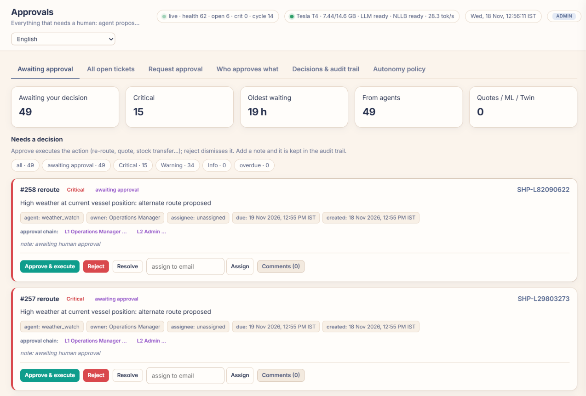
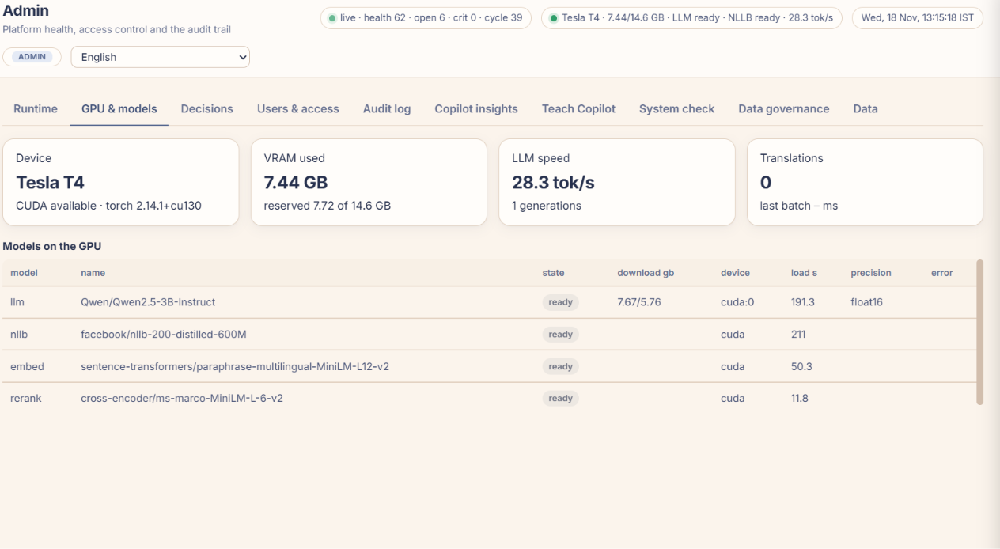
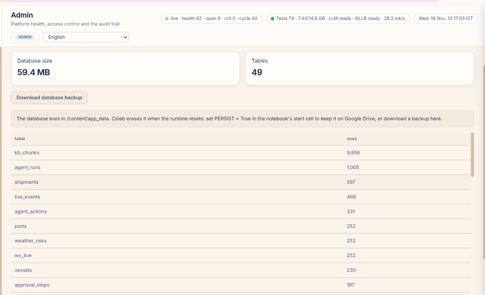
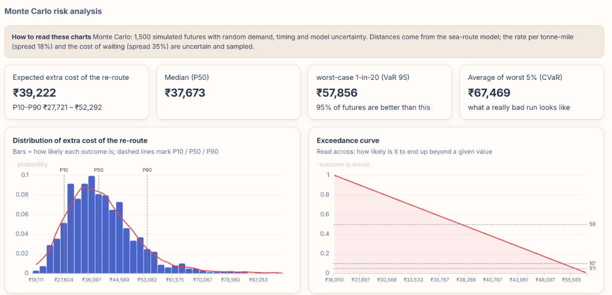
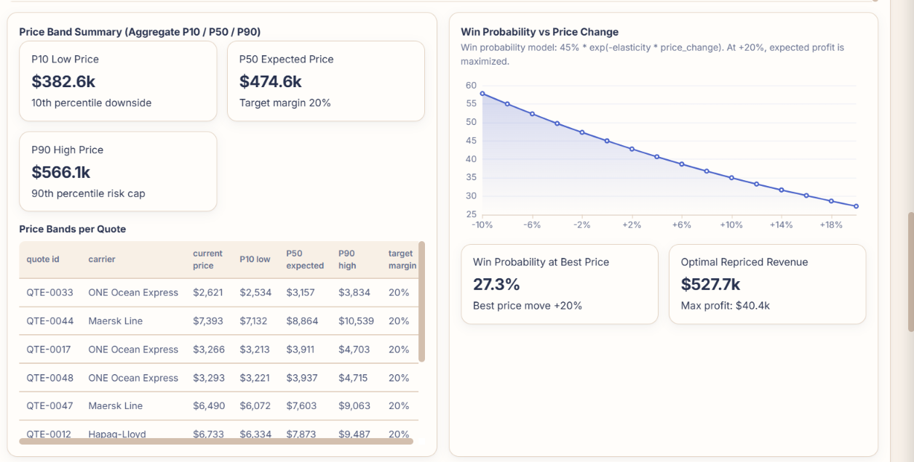
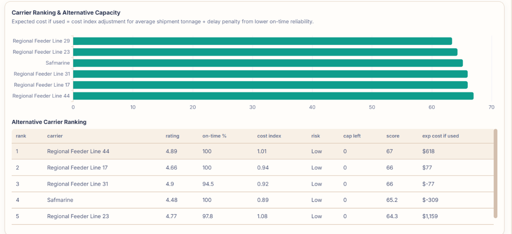

<h1 align="center">FreightQuote AI</h1>

<b>Agentic AI for Maritime Freight Pricing and Route Optimization</b>

Infosys Springboard 7.0 Internship &nbsp;|&nbsp; Batch 4 &nbsp;|&nbsp; Team 2 &nbsp;|&nbsp; Milestone 3

  
  
  
  
  

---

## Overview

FreightQuote AI is a web application in which a team of AI agents prices freight quotes, watches the fleet for weather, customs and congestion risk, and proposes actions that people approve. An AI Copilot answers questions in plain English. Every number it states comes from an exact SQL query, and its explanations come from a knowledge base of freight documents, cited with numbered sources. When the Copilot is not sure, it says "I do not know".

**Mentor:** Mohamedsipli M

### Milestone 3 at a glance

| Goal | Result |
|---|---|
| Knowledge base |  Documents on Incoterms, customs, shipping documents, ports, insurance and trade finance, built by web scraping and used by the Copilot with sources |
| Taught questions | 160 questions taught through Admin > Teach Copilot |
| Simulators | 5 agent simulators upgraded, each with assumptions, a P10 to P90 range and a fixed seed |
| Final application | Milestone 2 login, profile, role-based access and Admin dashboard running inside it |
| Deliverables | Both notebooks, taught_questions.csv, this README and the presentation (PPTX and PDF) |

---

## Tech stack

### Application

| Layer | Technology |
|---|---|
| Backend | FastAPI, Uvicorn (Python) |
| Live updates | Server-sent events (SSE) |
| Charts and maps | ECharts, Leaflet, TopoJSON |
| Database | SQLite |
| Backup | Google Drive |
| Background work | Separate worker process |

### Agents, models and data science

| Layer | Technology |
|---|---|
| Agent workflow | LangGraph |
| Quote agents | Route, weather, pricing, customs, margin, documents, alerts |
| Fleet watchers | Route, weather, customs, quote, anomaly |
| Price prediction | Random Forest (scikit-learn) |
| Anomaly detection | Isolation Forest (scikit-learn) |
| Simulators | NumPy, Monte Carlo runs with a fixed seed |
| Live weather | Open-Meteo |

### AI Copilot and knowledge base

| Layer | Technology |
|---|---|
| Language model | Qwen2.5-Instruct (3B on a T4 GPU) |
| Translation | NLLB-200, distilled 600M |
| Embeddings | paraphrase-multilingual-MiniLM-L12-v2 |
| Keyword search | BM25 |
| Vector search | FAISS |
| Rank fusion | Reciprocal Rank Fusion |
| Reranker | cross-encoder/ms-marco-MiniLM-L-6-v2 |
| Document reading | PyMuPDF, pdfplumber |
| Exact answers | Read-only SQL |

### Security and access

| Layer | Technology |
|---|---|
| Sign-in | JWT in a session cookie |
| Passwords | Salted password hashing, account lock after 5 wrong attempts |
| Access control | Role-based access control (5 roles) |
| Accountability | Audit log and two-step approvals |
| Secrets | Colab Secrets |

### Runtime

| Layer | Technology |
|---|---|
| Notebook platform | Google Colab with a T4 GPU |
| Public link | Colab proxy, ngrok as a fallback |
| Storage | Google Drive |
| Time zone | India Standard Time (IST) |

---

## How to run

You need a Google account, Google Colab with a GPU runtime (T4) and Google Drive.

### Step 1: Build the knowledge base (RAG notebook)

1. Open `FreightQuoteAI_RAG_Builder_FINAL_.ipynb` in Colab.
2. Choose **Runtime > Change runtime type > T4 GPU**.
3. Choose **Runtime > Run all** and allow access to Google Drive when Colab asks.
4. The notebook crawls the websites, downloads the PDFs, extracts the text and builds the indexes. Everything is saved to `MyDrive/FreightQuote_AI/`:
   - `rag_pdfs/` holds the downloaded PDFs.
   - `synthetic_kb/all_chunks.jsonl` holds the chunks that the app reads.
   - `faiss_indexes/` and `bm25_indexes/` hold the search indexes.
   - `kb_export.json` is an export that can be imported in the app.

### Step 2: Start the application (final notebook)

1. Open `Copy_of_FreightQuote_AI_Final_Code_UI_FIXED.ipynb` in Colab with a **T4 GPU**.
2. In the start cell, keep `USE_DRIVE = True` and `PERSIST = True`. This loads the chunks from Step 1 and backs up the database to `MyDrive/freight_quote_data/db`.
3. Add secrets in Colab (the key icon, with Notebook access turned on). None of them is required to start.
4. Choose **Runtime > Run all** and open the link printed at the end.
5. Sign in. The sign-in page has a **Quick demo sign-in** list with one user per role.
6. Open **Admin > System check**. The line **Knowledge base (RAG)** shows how many chunks are loaded.

Start the notebook about 15 minutes before a demo, because the models take a few minutes to load.

---

## Roles and access

| Role | What it can do |
|---|---|
| Customer | Requests quotes and sees only their own |
| Freight Broker | Handles quotes and customs documents |
| Operations Manager | Approves re-routes, holds and margin reviews, and runs agent cycles |
| Auditor | Read-only access |
| Admin | Everything above, plus policy, users, System check and Teach Copilot |

A role that tries something it is not allowed to do receives a **403** response and a clear message. Self-registered accounts are always Customers, and only an Admin can give another role.

---

## Agents, approvals and the Digital Twin

**Seven quote agents** build a quote: route, weather, pricing, customs, margin, documents and alerts.

**Five fleet watchers** run every 60 seconds and open tickets when they find a problem: `route_watch`, `weather_watch`, `customs_watch`, `quote_watch` and `anomaly_watch`.

**People stay in control.** Actions such as re-routes, quote holds and margin reviews go to an approval queue. Approvals follow a two-step chain (Operations Manager, then Admin), and every action is written to an audit log.

**The Digital Twin** runs what-if cases, such as a port strike, a fuel spike or a canal closure, on a private copy of the data. It shows the money impact, ranks the ways to reduce it, and never changes live data.

---

## How the Copilot uses SQL and RAG

The Copilot tries these layers in order. The first one that can answer wins.

1. **Taught answers.** If an Admin taught this question, or a rephrased version of it, the saved answer is returned.
2. **Small talk and repair.** Greetings, typos and follow-up questions such as "and for Maersk only?".
3. **Exact SQL.** The question is turned into a read-only database query. Every number the Copilot states comes from here, and the query can be shown.
4. **Agents.** For briefings and "why is this on hold" questions, the latest findings of the agents are added.
5. **RAG (knowledge base).** For "what is..." and "how do..." questions, the Copilot searches the documents and answers in short numbered points, `[1]` `[2]`, with a **Sources** list.
6. **Language model.** If it is loaded, Qwen2.5 writes a short explanation from the evidence. The code checks that every number it uses is in the evidence.
7. **"I do not know".** If nothing fits, the Copilot says so and saves the question in a backlog, so an Admin can teach the answer.

**How retrieval works.** The knowledge base is searched in two ways. BM25 matches the words, and embeddings match the meaning. The two ranked lists are combined with Reciprocal Rank Fusion, and a cross-encoder reranker puts the best passages first. Identical queries are cached until the knowledge base changes.

---

## Questions taught to the Copilot

Questions that the Copilot could not answer were taught through **Admin > Teach Copilot**, using a CSV import. The file is [`taught_questions.csv`](taught_questions.csv), with the columns `question`, `answer` and `keywords`. After teaching, each question is answered directly, and so are rephrased versions of it.

| Group | Examples |
|---|---|
| Shipping terms and basics | CIF, ETD, Certificate of Origin |
| About FreightQuote AI | Why a quote is On Hold, which models the Copilot uses, the Digital Twin |
| Incoterms | FCA, CPT, CIP, CFR, DAP, DPU |
| Customs and HS codes | HS code structure, customs valuation, Bill of Entry |
| Shipping documents | Master and house bill of lading, sea waybill, VGM |
| Demurrage, detention and ports | Free time, dwell time, blank sailing |
| Weather and route risk | Suez and Cape routing, monsoon, war risk insurance |
| Marine insurance and trade finance | Institute Cargo Clauses, letter of credit, UCP 600 |
| Rates and surcharges | BAF, CAF, THC, FAK, spot and contract rates |

---

## Simulator improvements

Each agent page has a **Simulator** tab (code in `sim_fq.py`). Every simulator now lists its assumptions, shows a 10th to 90th percentile range and not a single number, uses a fixed seed (42) so results repeat, reads its starting values from the database, and never changes live data.

| Simulator | What was added |
|---|---|
| Route | Canal and strait closures, a fuel price slider (-30% to +80%), and a comparison of three routes (A baseline, B scenario, C alternative) by days and cost |
| Quote | Target margin, fuel and exchange-rate changes, a price band (P10, P50, P90) and the chance of winning the quote |
| Carrier | On-time reliability shift (-20 to +10 points), capacity shortage, and a carrier ranking under a disruption |
| Weather | Storm intensity and duration (0.5x to 5x), delay days and the demurrage cost |
| Customs | Inspection rate (0 to 50%), missing-document delays, and the holding cost per day over 1 to 14 days |

---

## Milestone 2 work in the final app

- **Login and sign-up:** salted password hashing, a session cookie with a JWT, account lock after 5 wrong passwords, and password reset by security question or email code.
- **Profile page:** user details, preferences and password change.
- **Role-based access:** the menu changes by role, and forbidden actions return 403.
- **Admin dashboard:** Runtime, GPU and models, Decisions, Users and access, Audit log, Copilot insights, Teach Copilot, System check, Data governance and Data.
- **IST on every timestamp**, and no secrets in the code.

---
## Screenshots

All images are in the [`screenshots`](screenshots) folder.

### 1. Application

**Figure 1.** Sign in, with quick demo logins for each role

**Figure 2.** Approvals: tickets from the agents waiting for a decision

**Figure 3.** Digital Twin: what-if simulation on a private copy of the data

### 2. Admin

**Figure 4.** Admin > GPU and models

**Figure 5.** Admin > Data

### 3. Route simulator

**Figure 6.** Route planner

**Figure 7.** Route simulator: baseline

**Figure 8.** Route simulator: scenario

**Figure 9.** Route simulator: comparison of routes

### 4. Quote simulator

**Figure 10.** Quote simulator

**Figure 11.** Quote simulator: scenario with a price band

**Figure 12.** Margin

### 5. Carrier simulator

**Figure 13.** Carrier simulator

**Figure 14.** Carrier simulator: ranking under a disruption

### 6. Weather simulator

**Figure 15.** Weather simulator: delay days and demurrage cost

